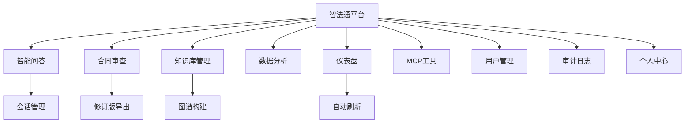
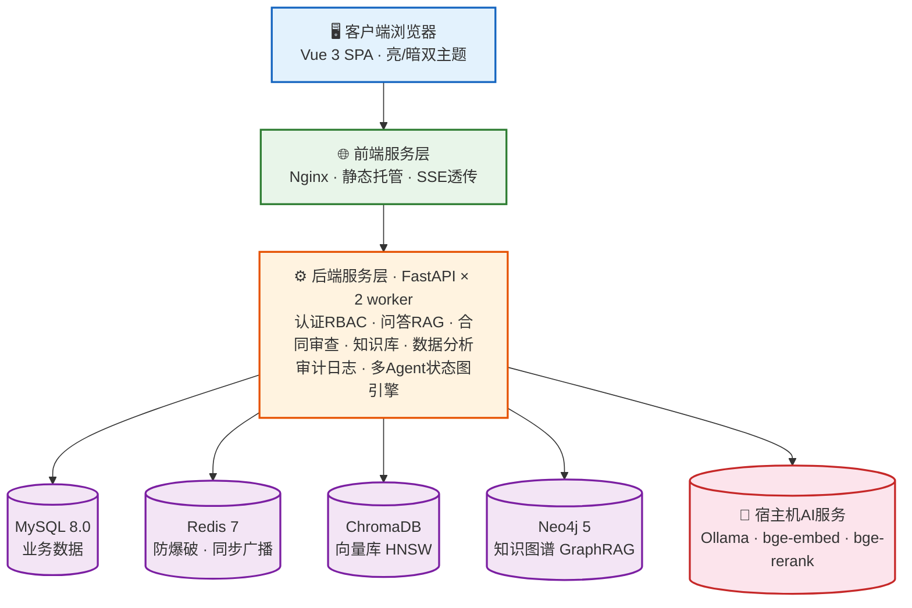

# 智法通项目介绍文档

> **企业级智能法律顾问平台 **
>
> AI 驱动 · 专业可信 · 数据隔离 · 开箱即用

---

## 目录

- [一、项目概述](#一项目概述)
- [二、系统架构](#二系统架构)
- [三、核心技术](#三核心技术)
- [四、功能模块](#四功能模块)
- [五、关键功能截图说明](#五关键功能截图说明)
- [六、权限与数据安全](#六权限与数据安全)

---

## 一、项目概述

### 1.1 项目定位

**智法通** 是一套面向企业与律所的**企业级智能法律顾问平台**，以本地化大模型（Ollama + Qwen）为推理底座，围绕法律场景构建了两大核心能力：

1. **智能法律问答（Legal RAG）**：基于"三路混合检索 + Cross-Encoder(Rerank) 精排 + Self-RAG 自评估"的检索增强生成链路，回答**引用真实法条**、标注**置信度**，并支持 **SSE 逐字流式输出**；
2. **多 Agent 对抗式合同审查**：以状态图引擎编排"条款拆分 → 法务/合规/业务三视角独立推理 → 主审风险识别 → 复核遗漏检查 → 反方辩论 → 仲裁裁决 → 风险评分 → 修改建议"，输出结构化审查报告与**带修改痕迹的 AI 修订版合同**。

平台采用**全容器化部署**（Docker Compose 一键拉起 MySQL / Redis / Neo4j / 后端 / 前端五服务），支持**多用户并发**与**角色分层数据范围**管理，开箱即用。

### 1.2 平台功能全景

---

## 二、系统架构

### 2.1 技术栈总览

| 层次 | 技术选型 | 说明 |
| --- | --- | --- |
| **前端** | Vue 3.4 + TypeScript + Vite 5 | 组合式 API，组件按路由懒加载分包 |
| | Element Plus 2.7 + ECharts 5.5 | 企业级组件库 + 可视化图表 |
| | Pinia 2 + Vue Router 4 | 状态管理（认证/主题/字典）+ 路由守卫 RBAC |
| | Nginx（alpine） | 静态托管 + `/api` 反向代理 + SSE 透传 |
| **后端** | Python 3.10 + FastAPI | 异步高性能框架，uvicorn 双 worker |
| | httpx（异步） | Ollama / 精排服务客户端，支持流式 |
| | 自研 StateGraph 引擎 | LangGraph 兼容语义的多 Agent 状态图编排 |
| **数据层** | MySQL 8.0 | 用户/合同/会话/消息/知识文档/审计（utf8mb4） |
| | Redis 7 | 登录防爆破计数 / 缓存 / 跨进程索引同步广播 |
| | ChromaDB（持久化） | 法律知识向量库（HNSW + 余弦相似度） |
| | Neo4j 5 Community | 法律知识图谱（GraphRAG 第三路召回） |
| **AI 层** | Ollama + qwen2.5:1.5b | 本地 LLM 推理（可替换更大参数模型） |
| | bge-large-zh-v1.5 | 1024 维中文向量嵌入 |
| | bge-reranker-v2-m3 | Cross-Encoder 精排服务 |
| **部署** | Docker Compose | 五服务编排，健康检查，数据卷持久化 |

### 2.2 容器服务规划

| 服务 | 容器名 | 宿主端口 | 说明 |
| --- | --- | --- | --- |
| 前端 | zhifatong-frontend | **8188** → 80 | Nginx 托管构建产物 |
| 后端 | zhifatong-backend | **28000** → 8000 | FastAPI API 服务 |
| MySQL | zhifatong-mysql | 13306 → 3306 | utf8mb4，首次启动自动建表 |
| Redis | zhifatong-redis | 26379 → 6379 | 512MB LRU |
| Neo4j | zhifatong-neo4j | 7474 / 7687 | HTTP / Bolt |

## 三、核心技术

### 3.1 GraphRAG 三路混合检索 + 精排（问答准确性的基石）

| 阶段                | 核心动作                         | 关键产出                |
| :------------------ | :------------------------------- | :---------------------- |
| ① 查询预处理        | 指代消解 → 查询重写 → 子查询分解 | 优化后的查询语句        |
| ② 三路混合召回      | 稠密向量 + BM25 + 图谱（并发）   | 多路候选文档            |
| ③ RRF 融合          | 倒数排序融合（k=60）             | 去重合并后的候选集      |
| ④ Cross-Encoder精排 | bge-reranker-v2-m3               | Top-5 高相关上下文      |
| ⑤ LLM流式生成       | 上下文拼装 + SSE逐字输出         | 流式回答（含引用编号）  |
| ⑥ Self-RAG自评估    | 法条准确性/逻辑完整性/事实一致性 | 三维置信度评分          |
| ⑦ 引用校验          | 回答法条 ↔ 检索结果比对          | 幻觉防护 + 效力状态标注 |

### 3.2 多 Agent 对抗式合同审查（StateGraph 编排）

| 设计要点       | 说明                                                         |
| :------------- | :----------------------------------------------------------- |
| **对抗制衡**   | 法务（主审）、合规（复核）、业务（反方）三个独立 Agent 从不同立场同步审查，避免单一视角带来的偏见或遗漏 |
| **必须回应**   | 主审必须逐条回应反方质疑，不可跳过，确保辩论实质性           |
| **仲裁兜底**   | 未共识时由仲裁 Agent 终局裁定，确保有结论                    |
| **真实性保障** | 每个 Agent 节点记录 LLM 真实调用标记与耗时，禁止占位造假     |
| **降级韧性**   | 任一 LLM 调用失败时按规则数据合成兜底，三方意见永不为空      |
| **过程可视化** | 报告内展示多 Agent 执行轨迹（各环节耗时与推理方式）          |

### 3.3 AI 修订版合同导出（修改痕迹可视化）

- 渲染四类痕迹：**【AI新增】绿色高亮 / 【AI修改】黄色高亮 + 红色删除线字符级 diff / 【AI删除】红色删除线**

## 四、功能模块

### 4.1 智能合同审查

- 双入口：粘贴文本（同步等待）或上传 docx/pdf/txt/md（异步受理 + 轮询）；
- 审查中展示七阶段进度动画（条款拆分 → 三视角推理 → 主审 → 复核 → 辩论 → 仲裁 → 报告）；
- 报告全可视化：概览指标 / 三视角审查意见（法务·合规·业务，标注 AI 推理来源）/ 风险清单 / 修改建议 / 对抗辩论推理链 / 多 Agent 执行轨迹，**不向用户暴露任何原始 JSON**；
- 审查记录分页管理，状态（审查中/已完成/失败）自动刷新上屏。

### 4.2 AI 修订版合同导出

- 记录列表与【查看报告】并列的【导出AI修改】按钮；
- 首次导出触发 LLM 逐条款改写（约 10-40s，结果缓存），生成 Word 下载；
- 修改痕迹四类标记 + 痕迹清单表，原文与 AI 改动一眼可辨。

### 4.3 知识库管理

- 四类文档 CRUD（法律法规/裁判案例/司法解释/合同模板），类型字典后端下发；
- 保存后自动执行：法律感知分块 → 向量入库 + BM25 同步 + 图谱写入（三路索引一致）；

### 4.4 数据分析

| 分析项 | 内容 | 数据范围 |
| --- | --- | --- |
| 咨询热点 | 业务领域分布饼图 / 日咨询量趋势 / 热点关键词词云 | 管理员=全平台；法务/用户=本人 |
| 法条引用 | 高频引用法条 Top20 柱图 / 法条共引关系网络（力导向图） | 同上 |
| 用户聚类 | K-Means 按行为特征分群（咨询/审查/置信度/活跃/角色五维） | 仅管理员（系统级功能） |

- 支持近 7/30/90 天周期切换；tab 切换自动重绘；数据变化自动刷新（快照比对防闪烁）。

### 4.5 仪表盘

- 六宫格核心指标 + 风险分布饼图 + 知识库构成玫瑰图 + 最近审查记录分页表；
- **角色感知数据范围**：管理员=全平台汇总（合同审查记录总数/咨询总数），法务/普通用户=仅本人数据；
- 30 秒自动刷新 + 窗口聚焦补刷，数据未变化不重绘（防闪烁）。

### 4.6 主题体验

- 顶栏格式刷风格切换控件（日/月滑块动画，登录页右上角同样提供）；

## 五、关键功能截图说明

### 5.1 登录与主题切换

**【登录页 · 亮色主题】**：展示系统登录首页，包含品牌Logo、登录注册表单、右上角亮暗色主题切换控件。

**【登录页 · 暗色主题】**：切换至暗色主题后的注册页面，展示整套暗色UI配色效果。

### 5.2 仪表盘

**【管理员仪表盘】**：管理员视角首页仪表盘，展示全平台统计指标、风险分布图表与近期审查记录表格。

**【普通用户仪表盘暗色效果】**：普通用户工作台仪表盘，仅展示当前用户个人业务统计数据。

### 5.3 智能法律问答

**【智能问答】**：法律问答页面，捕捉AI流式逐字输出过程，展示会话列表、检索提示与打字光标效果。

**【智能问答】**：问答会话完成页面，展示完整回答内容、法条引用卡片。

### 5.4 智能合同审查

**【合同审查 · 发起审查】**：合同审查发起页面，展示文本粘贴、文件上传双模式。

合同审查记录列表，展示不同状态记录、风险评分、操作按钮以及分页控件。

**【合同审查 · 审查中】**审查七阶段进度动画

**【审查报告详情】**：审查报告抽屉首屏，展示风险概览指标以及法务、合规、业务三方Agent审查意见卡片。

**【审查报告详情】**：审查报告滚动下半部分，展示风险清单、修改建议、对抗辩论链以及多Agent执行耗时轨迹。

**【AI 修订版合同 Word 文档】**：本地打开导出的AI修订Word文档，展示绿色新增、黄色修改、红色删除线的字符级修订痕迹。

### 5.5 知识库管理

**【知识库管理】**：知识库管理主页，展示统计数据、文档筛选搜索栏以及法律文档管理列表。

**【插入新增/编辑文档对话框】**：新增知识库文档弹窗，展示文档类型、标题、时效性、正文编辑表单。

### 5.6 数据分析

**【数据分析 · 咨询热点】**：数据分析‑咨询热点页面，展示业务分布环形图、咨询量趋势图

**【数据分析 · 法条引用】**：法条引用分析页面，展示高频法条柱状图以及法条共引关系力导向网络图。

暗色效果

### 5.7 系统管理与个人中心

**【用户管理】**：用户管理页面，展示账号列表、三级RBAC角色下拉选项、账号启停与密码重置操作项。

**【个人中心】**：个人中心页面，展示用户基础资料表单、密码修改模块以及当前角色权限说明清单。

## 六、权限与数据安全

### 6.1 三角色权限与数据范围

| 功能 | 管理员 | 法务负责人 | 普通用户 |
| --- | --- | --- | --- |
| 仪表盘 | **全平台汇总**（合同审查记录总数/咨询总数） | 仅本人数据 | 仅本人数据 |
| 智能问答 | 仅本人会话 | 仅本人会话 | 仅本人会话 |
| 合同审查记录 | **查看全部角色记录**；删除仅限本人 | 仅本人 | 仅本人 |
| 知识库管理 | ✅ 管理 | ✅ 管理 | ❌ 禁止访问 |
| 数据分析 | **全平台汇总** + 用户聚类 | 仅本人数据 | 仅本人数据 |
| 个人中心 | ✅ 本人 | ✅ 本人 | ✅ 本人 |
